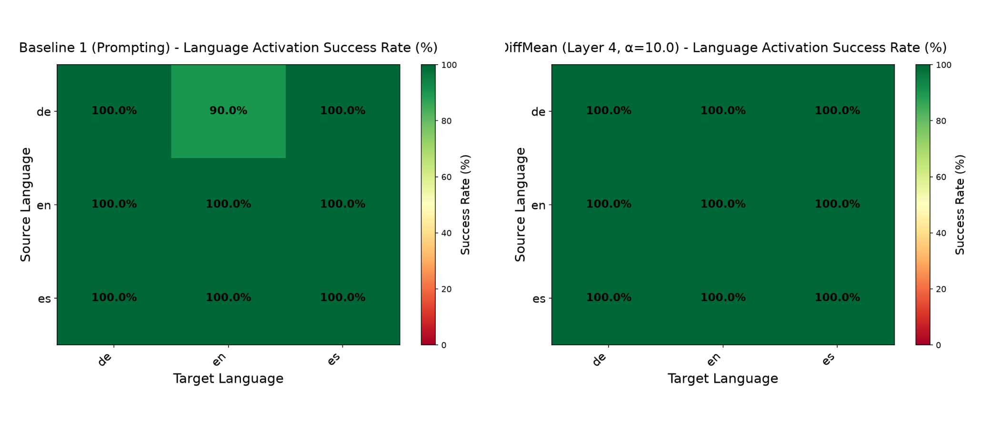

# Pilot Exploration: Baseline 1 vs. DiffMean Steering

This directory contains the initial pilot exploration comparing **Baseline 1** (in-context prompting) against **DiffMean** (internal representation steering) on `CohereLabs/aya-expanse-8b` across English (`en`), German (`de`), and Spanish (`es`).

---

## 1. Overview of Approaches

The goal is to force a language model to answer in a **Target Language** when given a prompt in a different **Source Language**, without compromising answer quality.

### Baseline 1 (Prompting / In-Context Steering)
- **Mechanism**: Modifies the text input by appending an explicit English instruction:
  ```python
  prompt = f"{question} Respond in {target_language}."
  ```
- **How it works**: Relies entirely on the LLM's instruction-following capabilities.
- **Behavior**: The model may occasionally disregard the directive and reply in the source language (e.g. answering a German question in German despite the English prompt).

### DiffMean (Difference-in-Means Representation Steering)
- **Mechanism**: Does **not** modify the prompt text (the model receives only the raw, unprompted source question). Instead, it shifts the internal residual stream representations during forward passes at inference time.
- **Activation Centroids**: Uses precomputed language activation centroids $\mu_l(L)$ across layers:

  $$
  \mu_l(L) = \frac{1}{N} \sum_{i=1}^{N} h_l^{(i)}
  $$

- **Steering Vector**: Computes the directional vector from source to target language:

  $$
  v_{\text{diff}} = \mu_l(L_{\text{target}}) - \mu_l(L_{\text{source}})
  $$

- **Forward Hook Intervention**: Adds the normalized direction scaled by steering strength $\alpha$ directly into the residual stream:

  $$
  h_l' = h_l + \alpha \cdot \frac{v_{\text{diff}}}{\|v_{\text{diff}}\|_2}
  $$

---

## 2. Evaluation Metric: Language Forcing Success Rate

Outputs are evaluated using Meta's NLLB FastText Language Identification model (`lid218e.bin`):

- **Success (1)**: If `FastText(output) == Target Language`
- **Failure (0)**: Otherwise

$$\text{Success Rate} = \frac{\text{Number of Successful Forcings}}{\text{Total Tested Questions}} \times 100\%$$

---

## 3. Pilot Results (`en`, `de`, `es`)

Evaluated on 9 language pairs ($3 \times 3$) with 10 questions per pair (90 generations total per approach):

| Metric | Baseline 1 (Prompting) | DiffMean (Layer 4, α = 10.0) |
|:---|:---:|:---:|
| **Overall Success Rate** | **98.9%** (89 / 90) | **100.0%** (90 / 90) |
| **Prompt Modified?** | Yes (`"Respond in X."`) | **No (Raw question only)** |
| **Target = German (`de`)** | 100.0% (30 / 30) | 100.0% (30 / 30) |
| **Target = Spanish (`es`)** | 100.0% (30 / 30) | 100.0% (30 / 30) |
| **Target = English (`en`)** | 96.7% (29 / 30) | 100.0% (30 / 30) |

### Side-by-Side Comparison Heatmap



---

## 4. Directory Structure

- `run_baseline_and_diffmean.ipynb`: Self-contained notebook with the complete executed run and output logs.
- `results/`:
  - `comparison_baseline1_vs_diffmean.png`: Side-by-side success rate heatmaps.
  - `baseline/`: FastText `analysis_results.json` for Baseline 1.
  - `diffmean/`: FastText `analysis_results.json` for DiffMean.

