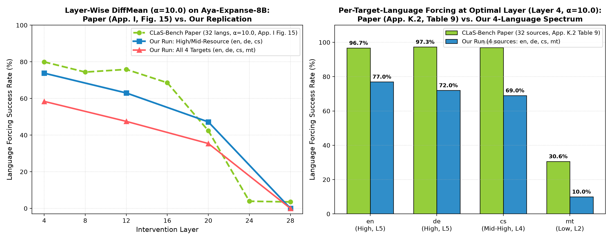
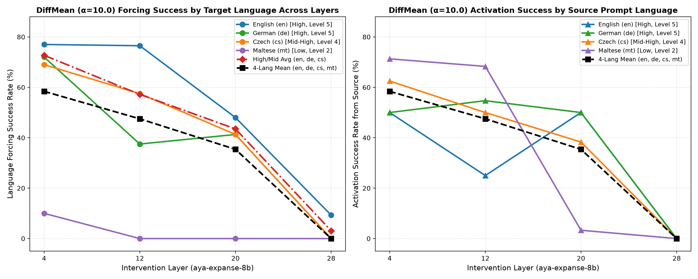

# Exploration 02: DiffMean Across Layers and Languages

Building on [Exploration 01](../01_baseline_vs_diffmean/README.md), this experiment evaluates **DiffMean** representation steering ($\alpha = 10.0$) on `CohereLabs/aya-expanse-8b` across **four layers (`4, 12, 20, 28`)** and **high-, mid-, and low-resource languages (`en`, `de`, `cs`, `mt`)**, replicating the CLaS-Bench paper ([*Gurgurov et al., 2026*](https://arxiv.org/abs/2601.08331)).

---

## 1. Overview & Setup

### DiffMean Steering
Instead of modifying the prompt text, DiffMean shifts internal residual-stream representations at layer $l$ using precomputed language centroids $\mu_l(L)$:

$$
v_{\text{diff}}^{(l)} = \mu_l(L_{\text{target}}) - \mu_l(L_{\text{source}})
$$

$$
h_l' = h_l + \alpha \cdot \frac{v_{\text{diff}}^{(l)}}{\|v_{\text{diff}}^{(l)}\|_2}
$$

### Tested Layers & Languages
- **Layers**: `4` (Early), `12` (Early-Mid), `20` (Mid-Late), `28` (Late, out of 32).
- **Strength**: $\alpha = 10.0$
- **Languages** *(from CLaS-Bench Appendix C, Table 4)*:

| ISO | Language | Family | Script | Resource Level (Joshi 1–5) |
|:---:|:---|:---|:---|:---:|
| **`en`** | English | Indo-European (Germanic) | Latin | **5 (High)** |
| **`de`** | German | Indo-European (Germanic) | Latin | **5 (High)** |
| **`cs`** | Czech | Indo-European (Slavic) | Latin | **4 (Mid-High)** |
| **`mt`** | Maltese | Afro-Asiatic (Semitic) | Latin | **2 (Low)** |

*(Note: We initially tested Tibetan `bo` as well, but removed it from the analysis because it scored `0.0%` target forcing across all layers—matching the paper's Table 9 where even Baseline-I prompting only reaches `5.8%`.)*

---

## 2. Results: Language Forcing Success Rate (%)

<b>What is the difference between Per-Target and Per-Source Success Rate? (Click to expand)</b>

 

Computed by [`evaluate_forcing_success.py`](../../CLaS-Bench/evaluate_forcing_success.py) using FastText (`lid218e.bin`):

- **Per-Target-Language Success Rate (Columns of the grid)**:
  - Answers: *"When we steer the model **toward** language $T$ (across all source languages), how often does FastText detect that the output is actually in language $T$?"*
  - **Example (`Target = English (en)` at Layer 4)**:
    - 5 source languages $\times$ 20 questions = **100 total tests** (`en->en`, `de->en`, `cs->en`, `mt->en`, `bo->en`).
    - FastText detected English in **77 out of 100** outputs $\to$ **`77.0% (77/100)`**.

- **Per-Source-Language Activation Success Rate (Rows of the grid)**:
  - Answers: *"When the input question is written **in** source language $S$ (and we steer it toward each target language), how often does steering succeed?"*
  - **Example (`Source = Maltese (mt)` at Layer 4)**:
    - 4 target languages $\times$ 20 questions = **80 total tests** (`mt->en`, `mt->de`, `mt->cs`, `mt->mt`).
    - Steering succeeded in **57 out of 80** outputs $\to$ **`71.3% (57/80)`**.

### Per-Target-Language Success Across Layers

| Target Language | Layer 4 | Layer 12 | Layer 20 | Layer 28 |
|:---|:---:|:---:|:---:|:---:|
| **English (`en`)** | **77.0%** (77/100) | 76.5% (65/85) | 48.0% (36/75) | 9.3% (7/75) |
| **German (`de`)** | **72.0%** (72/100) | 37.5% (30/80) | 41.3% (31/75) | 0.0% (0/75) |
| **Czech (`cs`)** | **69.0%** (69/100) | 57.5% (46/80) | 41.3% (31/75) | 0.0% (0/75) |
| **Maltese (`mt`)** | **10.0%** (10/100) | 0.0% (0/80) | 0.0% (0/75) | 0.0% (0/75) |
| **Only High/Mid-Resource Avg (`en, de, cs`)** | **73.8%** (177/240) | **63.0%** (126/200) | **47.2%** (85/180) | **0.0%** (0/180) |
| **Overall Avg (`en, de, cs, mt`)** | **58.4%** (187/320) | **47.5%** (126/265) | **35.4%** (85/240) | **0.0%** (0/240) |

### Per-Source-Language Success Across Layers

| Source Language | Layer 4 | Layer 12 | Layer 20 | Layer 28 |
|:---|:---:|:---:|:---:|:---:|
| **Maltese (`mt`)** | **71.3%** (57/80) | **68.3%** (41/60) | 3.3% (2/60) | 0.0% (0/60) |
| **Czech (`cs`)** | **62.5%** (50/80) | **50.0%** (30/60) | 38.3% (23/60) | 0.0% (0/60) |
| **English (`en`)** | **50.0%** (40/80) | 25.0% (20/80) | **50.0%** (30/60) | 0.0% (0/60) |
| **German (`de`)** | **50.0%** (40/80) | **54.7%** (35/64) | **50.0%** (30/60) | 0.0% (0/60) |

---

## 3. Visualizations

### Comparison with Paper (Appendix I Fig. 15 & Appendix K.2 Table 9)

### Target vs. Source Language Across Layers

---

## 4. Quick Observations

- **Layer Trend**: Similar to the paper's finding (*Appendix I, Fig. 15 & Appendix J, Table 6*) where **Layer 4 ($\alpha=10.0$)** is optimal for `Aya-Expanse-8B` (**73.8%** on `en, de, cs`), while deeper layers degrade (`Layer 4 > 12 > 20 > 28`) and collapse at Layer 28.
- **Low-Resource Target Bottleneck vs. Source Asymmetry**: Just as in the paper (*Appendix K.2, Table 9*), DiffMean struggles to steer *into* low-resource Maltese (`mt`: 10.0% vs. 30.6% in paper), yet steering *out of* `mt` into `en, de, cs, mt` succeeds **71.3%** of the time at Layer 4 (~95% when targeting `en, de, cs`).
- **Colab T4 Configuration**: Ran in 4-bit NF4 (`--quantization bitsandbytes --dtype float16 --max_model_len 2048`) with 15 questions each (`CLAS_BENCH_K=15`) and `CLAS_BENCH_MAX_TOKENS=300` to cut running times (the iterations to run this comes from the combination of # of languages and # of questions. For reference, 4 languages x 15 questions lasted a few hours).

---

## 5. Directory Structure

- `run_diffmean_multilayer.ipynb`: Executed Colab notebook with full logs and inline plots.
- `results/`:
  - `paper_vs_replication_diffmean_aya.png`: Comparison against the CLaS-Bench paper.
  - `diffmean_layer_ablation.png`: Target and source curves across Layers `4, 12, 20, 28`.
  - `diffmean_layers_4_12_20_28_summary.json`: Extracted metrics in JSON format.
  - `diffmean_evaluation_stdout.txt`: Raw FastText evaluation tables for all 4 layers.
